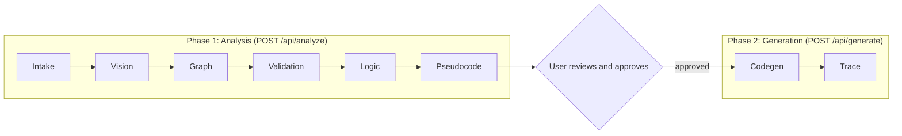
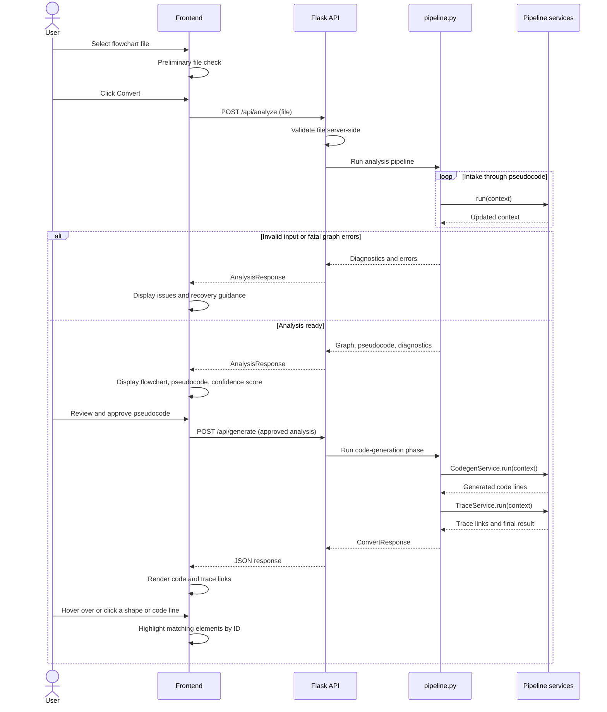

# Modulo (Flowchart-to-Code)

**Upload a completed flowchart. Review the logic. Get traceable Python, generated by rules rather than a language model.**

> **Current implementation (Stage 3):** the complete deterministic pipeline is implemented: Intake → Vision → Graph → Validation → Logic → Pseudocode → Approval → Codegen → Trace. The web interface accepts PNG, JPG, SVG, and single-page PDF files, shows a recognition confidence score, flags uncertain recognition, permits constrained corrections to flagged regions, and requires approval before Python generation. A one-command desktop installer and launcher (macOS, Windows, Linux) bundles everything the app needs, opens it in the browser, and adds a desktop app icon. The supported notation is specified in Section 3.3.

> **Local setup verified:** Python 3.12.9, Tesseract 5.5.3, and the pinned dependencies in `requirements.txt`. On macOS, if Control Center/AirPlay occupies port 5000, run `PORT=5001 python backend/app.py` and open <http://127.0.0.1:5001>. Do not stop system services just to run Modulo.

Modulo is an open-source web application that converts a single-page flowchart (PNG, JPG, SVG, or PDF) into executable Python. Every step of the conversion is deterministic: computer vision and OCR recognize the diagram, graph algorithms check it, and fixed translation rules turn it into pseudocode and then code. No LLM or AI model is called anywhere in the system.

Built by **West Texas System Solutions** for CS4366: Senior Capstone (Fall 2026): Kaleb Rodriguez, Keegan Irish, Destiny Lopez, Alejandro Bravo, and Joseph Chandy.

---

## Table of Contents

1. [Overview](#1-overview)
2. [Purpose and Motivation](#2-purpose-and-motivation)
3. [Scope](#3-scope)
4. [How It Works](#4-how-it-works)
5. [Where It Runs](#5-where-it-runs)
6. [Tech Stack](#6-tech-stack)
7. [Repository Structure](#7-repository-structure)
8. [File Reference](#8-file-reference)
9. [Architecture](#9-architecture)
10. [Features](#10-features)
11. [Getting Started](#11-getting-started)
12. [Recognition Quality and Confidence](#12-recognition-quality-and-confidence)
13. [Testing](#13-testing)
14. [Known Limitations](#14-known-limitations)
15. [Roadmap](#15-roadmap)
16. [Open Decisions](#16-open-decisions)
17. [License](#17-license)

---

## 1. Overview

A user uploads a finished flowchart. Modulo then:

1. **Recognizes** the diagram's shapes, connectors, and text (OpenCV and Tesseract).
2. **Builds and validates** a graph of the diagram, checking connectivity and structure.
3. **Translates** the supported control flow into pseudocode through an intermediate representation (IR).
4. **Waits for the user to review and approve** the pseudocode.
5. **Generates Python** with deterministic rules and checks that the result is syntactically valid.
6. **Links everything back**: hovering a flowchart shape highlights the pseudocode and code it produced, and hovering a code line highlights the shape it came from.

The core idea is that the user has already done the hard part (designing the logic as a flowchart). Modulo's job is to translate that design faithfully and to show its work.

---

## 2. Purpose and Motivation

- **Structure first, code second.** Prompt-based AI tools produce code whose structure is hard to predict or maintain. Modulo starts from a flowchart, so the program's structure is decided by the user before any code exists.
- **Predictable and explainable.** The same flowchart always produces the same pseudocode and code, and every output line can be traced to a flowchart element and the rule that produced it. This directly serves the three needs raised in the project interviews: a visible link between symbols and code, edge cases that are flagged rather than assumed, and a chance to check behavior before relying on the output.
- **Honest about uncertainty.** Deterministic conversion removes hallucination, but it does not remove recognition errors: the vision and OCR stages can still misread a diagram. That is why Modulo reports diagnostics, shows a confidence score, flags low-confidence elements, and requires approval before generating code.
- **Open source.** The repository is public so the project can be inspected, run locally, and extended.

**Target users** are non-technical to semi-technical people who supply a proper flowchart and want working code from it. They do not need programming experience, but they are expected to draw in standard notation and to be comfortable in a web browser.

---

## 3. Scope

### 3.1 In scope (MVP and Stage 3 additions)

- Upload one single-page flowchart as PNG, JPG, SVG, or PDF (drag and drop or file picker), or try a built-in sample.
- Recognize standardized flowchart elements with OpenCV and Tesseract.
- Build a flowchart graph and validate connectivity and structure with explicit algorithms.
- Translate supported control flow into pseudocode through an intermediate representation.
- Show a **recognition confidence score** and per-element flags so users can see how certain the system is.
- Show the pseudocode and **require user approval** before any code is generated.
- Allow constrained edits only for regions explicitly flagged by OCR or branch-label diagnostics, then revalidate them through the same pipeline.
- Allow limited pseudocode editing (numeric values can be changed and reassessed; see [Known Limitations](#14-known-limitations)).
- Generate Python with deterministic rules, then check its syntax (without executing it).
- Preserve source element IDs through every stage, enabling hover highlighting and click-to-scroll between flowchart, pseudocode, and code.
- Flag ambiguous or unsupported parts of the diagram instead of guessing.
- Copy-to-clipboard and download of the generated script.
- Light and dark themes.
- Desktop launcher for macOS, Windows, and Linux.
- No sign-in and no saved data after the session.

### 3.2 Not yet implemented

- Sign-in and accounts
- Saving projects and version history
- Formal approval sign-off workflow (the MVP has a single Approve action)
- In-browser test mode (running the generated code)
- Full pseudocode and code editing, and syncing changes back to the flowchart (conditionals and text outputs are not yet reliably editable)
- Correction of shape geometry or unflagged text; flagged OCR and branch-label corrections are supported in controlled review mode
- Output languages other than Python (for example Java and C++)
- Multi-page documents. Photographs and hand-drawn sketches are accepted but have a higher recognition risk than clean exports.

### 3.3 The supported flowchart language

Because conversion is rule-based, Modulo can only translate what it has a rule for. The supported language is a subset of **ISO 5807** flowchart notation. This section is the notation specification. It is encoded in code in [`backend/notation.py`](backend/notation.py), which is the single source of truth.

| Symbol | Shape | Text it contains | Generated Python |
|---|---|---|---|
| Terminal | Rounded rectangle or oval | `Start` or `End` | Opens and closes the `main()` function |
| Process | Rectangle | A statement such as `total = total + n`; the supported high-level command `Calculate factorial` (or `Calculate factorial of n`) | Ordinary statements are validated and emitted as written; factorial is lowered to a safe multiplication loop |
| Data Input | Parallelogram | `Input n` or `Input n:int` | `n = input()` or `n = int(input())` |
| Data Output | Parallelogram | `Output total` or `Output "Done"` | `print(total)` or `print('Done')` |
| Decision | Diamond | A condition such as `n > 0` | `if n > 0:` ... `else:` |
| Iteration | Hexagon (or a Decision diamond that an arrow loops back to) | `WHILE <condition>` or `FOR <name> IN <expression>` | `while ...:` or `for ... in ...:` |
| Connector | Small circle | A matching label (`A`, `B`, ...) | Nothing (it only joins parts of the graph) |
| Flow arrow | Arrow | Optional label | Control flow between blocks |

**Supported logic:** sequential execution, if/else (including nested), `while` and `for` loops, variable assignment, logical expressions, input/output, the explicit high-level process command `Calculate factorial` (with one input, or `Calculate factorial of n` when multiple inputs exist), and optional `break`, `continue`, and `return` (drawn as Process boxes containing only that word). When an untyped input is compared with a numeric literal, code generation infers an integer input unless the diagram explicitly annotates a type.

**Edge labels:** every Decision and Iteration shape has exactly two outgoing arrows labeled `Yes` and `No` (also accepted: `True`/`False`, `Y`/`N`, in any letter case). For an Iteration, `Yes` enters the loop body and `No` leaves the loop; that `No` arrow is the loop's only exit. A post-test (do-while) loop, with the body drawn before the diamond, is supported.

**Output text:** put literal text in quotes (`Output "Even"`). A single unquoted word (`Output Even`) is read as a variable name, so code generation stops at an undefined variable.

The in-app **Diagram Guide** presents these rules for users, along with the layout conventions that recognize most reliably; keep it in step with this section.

**Statements and conditions** are limited to a small, safe language: names, numbers, strings, arithmetic, comparisons, `and`/`or`/`not`, and a short allowlist of built-ins (`print`, `input`, `int`, `float`, `str`, `len`, `range`, `abs`, `min`, `max`, `round`). The factorial command is a narrow, explicitly implemented exception to the expression grammar; unknown natural-language process text still produces a diagnostic rather than being passed into the output.

**Input rules:**

- One page, with exactly one `Start` terminal.
- Digital exports are preferred. Photographs and hand-drawn sketches are accepted, but perspective, lighting, paper texture, and handwriting can lower OCR and shape confidence.
- Dark lines on a light background, legible text, arrows with visible heads, shapes that do not overlap.
- Structured flow only: the diagram must be expressible as sequences, if/else, and loops. Jumps that cannot be expressed that way are reported as errors, naming the elements involved.

> **Error handling:** error paths drawn as ordinary decisions (for example "File found?" with a `No` path that prints a message) are fully supported. Generating `try`/`except` blocks is an open decision (see [Section 16](#16-open-decisions)).

---

## 4. How It Works

### 4.1 The pipeline

The work is split into two phases with a human approval gate between them.



Each stage is one file in `backend/services/`. Every service has the same shape: it receives the shared `PipelineContext`, adds its results, and returns the updated context.

| Stage | Service | Input to output | Main techniques |
|---|---|---|---|
| 1. Intake | `intake_service.py` | Uploaded bytes to a normalized page image | Decode PNG/JPG, render the PDF page, check it is a single page, scale and clean the image |
| 2. Vision | `vision_service.py` | Page image to recognized shapes, connectors, and text | OpenCV contour and line analysis, geometry-based shape classification, Tesseract OCR with per-word confidence |
| 3. Graph | `graph_service.py` | Recognized elements to a `FlowGraph` | Attach arrow ends to shapes, apply arrowhead direction, attach labels to edges |
| 4. Validation | `validation_service.py` | `FlowGraph` to diagnostics | Start/End checks, reachability, branch checks, statement parsing with Python `ast`, OCR confidence and ambiguity checks |
| 5. Logic | `logic_service.py` | `FlowGraph` to intermediate representation | Structured control-flow recovery (loops, merge points) |
| 6. Pseudocode | `pseudocode_service.py` | IR to numbered pseudocode lines | Template rendering |
| 7. Codegen | `codegen_service.py` | IR to Python source lines | Template rendering plus `ast.parse` and `compile` syntax check |
| 8. Trace | `trace_service.py` | All stages to a two-way trace map | Index of element ID to pseudocode lines to code lines, with a coverage check |

**How the Logic stage recovers structure.** It finds loops by looking for back edges (an edge pointing to a node that dominates its source), finds where the two branches of a decision rejoin (the decision's immediate post-dominator), and then builds the IR as a tree of `Sequence`, `If`, and `While` nodes. If the graph cannot be reduced to those forms, the stage stops with an `UNSTRUCTURED_FLOW` error that names the offending elements. NetworkX may be used internally for dominator and reachability calculations.

**One IR, two renderers.** Pseudocode and Python are both rendered from the *same* IR. What the user approves is therefore exactly what gets generated, and the pseudocode is never re-parsed.

### 4.2 Request lifecycle



Step by step:

1. **Select a file.** `upload.js` runs a preliminary check (extension and size) so the user gets instant feedback. The server never trusts this check.
2. **Click Convert.** `app.js` sends the file to `POST /api/analyze`.
3. **Server-side validation.** `app.py` checks the request itself: file present, size limit, allowed extension, and that the content really is the claimed type.
4. **Analysis pipeline.** `pipeline.analyze()` runs the six analysis services in order. It stops at the first error-level diagnostic.
5. **Failure path.** The response has `status: "failed"` plus diagnostics. The UI explains what went wrong, highlights the affected shapes, and says how to fix the diagram.
6. **Success path.** The context is saved in the analysis store under a random `analysis_id`. The response contains the recognized graph geometry, the pseudocode, the recognition scores, and any warnings.
7. **Review and approve.** The user inspects the flowchart and pseudocode side by side. Warnings are shown on the affected elements. Approve is the only way forward.
8. **Generate.** The UI sends only the `analysis_id` to `POST /api/generate`. The server loads the approved analysis from the store; it never accepts analysis content back from the browser.
9. **Expired analysis.** If the ID is unknown or has expired, the user is asked to upload again.
10. **Codegen and trace.** `CodegenService` renders Python from the IR and syntax-checks it. `TraceService` builds the two-way trace map.
11. **Render.** The UI shows the code with trace links.
12. **Hover and click.** `highlighter.js` highlights every element that shares a source ID with the hovered shape or line; clicking a flowchart shape scrolls the matching pseudocode and Python lines into view.

### 4.3 Traceability: how IDs flow

Every recognized element receives a stable ID in the Vision stage (`n1`, `n2`, ... for nodes and `e1`, `e2`, ... for edges). That ID is carried unchanged through every later stage.

```
n4 (Vision) -> graph node n4 -> IR node source_ids ["n4"]
            -> pseudocode lines 4 and 7 -> Python line 4
```

The frontend marks each shape overlay, pseudocode line, and code line with its source IDs (`data-source-ids="n4"`). One event handler matches on those IDs, so no per-element wiring is needed.

### 4.4 Worked example

A flowchart that reads a number and sums the integers from `n` down to 1:

| Flowchart element | ID | Pseudocode | Python |
|---|---|---|---|
| Terminal `Start` | `n1` | `START` | `def main():` |
| Data Input `Input n:int` | `n2` | `INPUT n` | `n = int(input())` |
| Process `total = 0` | `n3` | `SET total TO 0` | `total = 0` |
| Iteration `WHILE n > 0` | `n4` | `WHILE n > 0` / `END WHILE` | `while n > 0:` |
| Process `total = total + n` | `n5` | `SET total TO total + n` | `total = total + n` |
| Process `n = n - 1` | `n6` | `SET n TO n - 1` | `n = n - 1` |
| Data Output `Output total` | `n7` | `OUTPUT total` | `print(total)` |
| Terminal `End` | `n8` | `END` | End of `main()` |

```python
def main():
    n = int(input())
    total = 0
    while n > 0:
        total = total + n
        n = n - 1
    print(total)


if __name__ == "__main__":
    main()
```

The `if __name__ == "__main__":` lines are fixed scaffolding and carry no source ID. The trace coverage check treats Start, End, and Connector nodes as structural and expects every other node to map to at least one code line.

### 4.5 Determinism rules

For a fixed environment, the same input file produces byte-identical output. Contributors keep it that way by following these rules:

- IDs are assigned in a fixed reading order (top to bottom, then left to right), never in whatever order a library happens to return objects.
- Output is built from lists and sorted collections. Never iterate over a `set` or rely on hash ordering when emitting anything.
- No timestamps, random values, or environment-dependent text in generated pseudocode or code. (`analysis_id` and expiry times are response metadata only.)
- Translation rules live in templates and tables, not in scattered conditionals.
- Recognition (OpenCV, Tesseract) can differ between library versions, so dependency versions are pinned and the Tesseract version is documented. Below the recognition layer, identical graph data always yields identical pseudocode and code.

---

## 5. Where It Runs

- **Client-server architecture.** The browser is the client. A Python Flask server runs the pipeline.
- **Runs locally.** Clone the repository and start the server on your own machine, either directly with Python or through the desktop launcher. Flask serves both the API and the static frontend from the same address, so there is no separate frontend server and no cross-origin configuration.
- **Not static hosting.** GitHub Pages cannot run a Python backend. The repository is hosted on GitHub, but Modulo is run from a local clone.
- **No external services.** There are no calls to AI services or any other third-party API. Uploaded flowcharts never leave the machine running the server.
- **No accounts, no persistence.** Nothing is saved after the session. Uploaded data lives only in the server's memory, and only for the short gap between the review step and the generation step (see [Analysis store](#94-analysis-store)). The only thing the browser remembers is the chosen light or dark theme.
- **Browsers.** Current versions of major browsers.

---

## 6. Tech Stack

| Area | Tools |
|---|---|
| Frontend | HTML, CSS, vanilla JavaScript |
| Backend API | Python, Flask |
| Image processing | OpenCV (`opencv-python-headless`), NumPy |
| OCR and PDF processing | Tesseract, `pytesseract`, PyMuPDF |
| Graph representation | Own graph models; NetworkX optionally for graph algorithms |
| Logic and code generation | Python algorithms, templates, intermediate representation |
| Syntax validation | Python `ast` and `compile` checks (source is checked, never executed) |
| Packaging | Desktop launcher (`modulo_launcher.py`), PyInstaller (`modulo.spec`), Inno Setup (Windows installer) |
| Testing | pytest |

**Dependency notes**

- **Tesseract is a system program, not a pip package.** `pytesseract` only calls it, so Tesseract must be installed separately (see [Getting Started](#11-getting-started)).
- **`opencv-python-headless`** is used instead of `opencv-python` because the server needs no GUI libraries.
- **PyMuPDF** is licensed under AGPL-3.0 (with a commercial option). See [Open Decisions](#16-open-decisions) for the implications and a permissive alternative.

---

## 7. Repository Structure

```
modulo/
├── frontend/
│   ├── index.html
│   ├── css/styles.css
│   ├── js/
│   │   ├── app.js
│   │   ├── upload.js
│   │   ├── highlighter.js
│   │   └── heartbeat.js
│   └── icons/                      # favicons, app icons, web manifest
│
├── backend/
│   ├── app.py
│   ├── config.py
│   ├── models.py
│   ├── notation.py
│   ├── pipeline.py
│   ├── analysis_store.py           # temporary state between phases
│   └── services/
│       ├── intake_service.py
│       ├── vision_service.py
│       ├── connector_geometry.py
│       ├── graph_service.py
│       ├── validation_service.py
│       ├── programming_ocr_validation.py
│       ├── logic_service.py
│       ├── pseudocode_service.py
│       ├── codegen_service.py
│       └── trace_service.py
│
├── modulo_launcher.py              # desktop launcher entry point
├── modulo.spec                     # PyInstaller build specification
├── requirements.txt
├── requirements-build.txt          # extra dependencies for packaging
├── Install Modulo (Mac).command    # one-click installers
├── Install Modulo (Windows).bat
├── Install Modulo (Linux).sh
├── Uninstall Modulo (Windows).bat
├── INSTALL.txt
├── installer/                      # scripts used by the installers
│   ├── install-unix.sh
│   ├── install-windows.ps1
│   ├── uninstall-windows.ps1
│   └── modulo.iss                  # Inno Setup script (Windows)
├── assets/                         # icons used by the build and installers
├── .github/workflows/release.yml   # release build workflow
│
├── samples/                        # ten annotated sample charts (structural ground truth)
├── accepted_flowcharts/            # verified charts and the Try a Sample rotation (rotation.json)
├── test_flowcharts/                # manual and stress-test charts (see 8.5)
├── tests/                          # automated tests and ground truth (see 8.4)
│
├── docs/
│   └── RECOGNITION_FIXES.md
├── pytest.ini
├── LICENSE
├── .gitignore
└── README.md
```

---

## 8. File Reference

### 8.1 Frontend (`frontend/`)

| File | Purpose |
|---|---|
| `index.html` | Page structure: persistent header with theme toggle, upload controls, three side-by-side panels (flowchart, pseudocode, Python), a recognition-score area, and a diagnostics area. |
| `css/styles.css` | All styling. Defines the color tokens as CSS custom properties for light and dark themes, the panel layout, and the highlight styles. |
| `js/app.js` | Application controller. Holds the UI state (idle, file selected, analyzing, failed, review, generating, done), calls the API, renders the panels, confidence score, and diagnostics, and handles approval, flagged-region corrections, and replacement. |
| `js/upload.js` | File selection and drag-and-drop, the preliminary check (type and size), the file preview, and the progress and cancel behavior during upload. |
| `js/highlighter.js` | Linked highlighting. Matches `data-source-ids` across the flowchart overlay, pseudocode lines, and code lines; supports hover, keyboard focus, click-to-pin, and click-to-scroll to the matching lines. |
| `js/heartbeat.js` | Keeps the browser page in contact with the local server. |
| `icons/` | Favicons, app icons, and `site.webmanifest`. |

<!-- CONFIRM: heartbeat.js purpose (for example, lets the launcher know the page is still open). -->

### 8.2 Backend (`backend/`)

| File | Purpose |
|---|---|
| `app.py` | Flask application. Serves the frontend, defines the API routes, validates requests, calls `pipeline.py`, talks to the analysis store, and turns results into JSON. Contains no recognition or translation logic. |
| `config.py` | All tunable settings in one place (upload limits, allowed types, OCR confidence threshold, store lifetime, Tesseract path), with environment-variable overrides. |
| `models.py` | Shared data classes: bounding boxes, nodes, edges, `FlowGraph`, diagnostics, IR nodes, pseudocode lines, code lines, the trace map, `PipelineContext`, `AnalysisResponse`, and `ConvertResponse`. Includes JSON conversion. |
| `notation.py` | The single source of truth for the supported flowchart language: shape types, keywords, edge-label vocabulary, and the allowlist of statement forms and built-ins. Used by Vision, Validation, and Logic. |
| `pipeline.py` | Orchestrator. `analyze()` runs the six analysis services in order and stops at the first fatal error; `generate()` runs Codegen and Trace. Knows nothing about HTTP or storage. |
| `analysis_store.py` | Temporary in-memory storage of an analysis between the review request and the generation request. Expires old entries. Not permanent storage. |
| `services/intake_service.py` | Decodes PNG or JPG, renders SVG and PDF pages, rejects multi-page files, and normalizes the image (size, grayscale, threshold) for Vision. |
| `services/vision_service.py` | Finds shapes, connectors, arrowheads, and text. Classifies shapes by geometry, runs OCR with confidence scores, and assigns stable IDs in reading order. |
| `services/connector_geometry.py` | Geometry helpers for tracing connectors and arrowheads between shapes. |
| `services/graph_service.py` | Turns recognized elements into a `FlowGraph`: connects arrows to shapes, orients edges, attaches labels, and identifies the Start and End nodes. |
| `services/validation_service.py` | Structural and notation checks: one Start, reachable nodes, a path to an End, two labeled branches per decision, paired connectors, parsable and allowed statements, and low OCR confidence. Emits diagnostics. |
| `services/programming_ocr_validation.py` | Flags likely OCR confusions in programming-like text (for example `=` versus `==`) and keeps alternative readings for review. |
| `services/logic_service.py` | Converts the validated graph into the intermediate representation (sequences, if/else, loops, break/continue/return) and reports flow it cannot structure. |
| `services/pseudocode_service.py` | Renders the IR into numbered, indented pseudocode lines, each with its source IDs. |
| `services/codegen_service.py` | Renders the IR into Python lines with source IDs, then syntax-checks them with `ast.parse` and `compile`. Never executes the code. |
| `services/trace_service.py` | Builds the two-way trace map (element to pseudocode to code and back), checks that every node is covered, and assembles the final result. |

### 8.3 Launcher and installers

| File | Purpose |
|---|---|
| `Install Modulo (Mac).command`, `Install Modulo (Windows).bat`, `Install Modulo (Linux).sh` | One-click installers. Each bundles everything Modulo needs, adds a Modulo icon to the desktop, and opens the app in the browser. Verified on macOS and Windows. |
| `Uninstall Modulo (Windows).bat` | Removes the Windows installation. |
| `INSTALL.txt` | Short install instructions for users. |
| `installer/` | Scripts the installers call: `install-unix.sh`, `install-windows.ps1`, `uninstall-windows.ps1`, and the Inno Setup script `modulo.iss`. |
| `modulo_launcher.py` | Launcher entry point. Starts the local Modulo server and opens the app in the browser. |
| `modulo.spec`, `requirements-build.txt` | PyInstaller build specification and the extra dependencies needed to package the app. |
| `.github/workflows/release.yml` | GitHub Actions workflow for release builds. |
| `assets/` | The three icon files the build and installers use: `modulo.ico` (Windows executable and shortcut), `modulo.png` (source for the macOS icon set), and `modulo-m-icon.svg` (Linux launcher icon and desktop window icon). The web interface's own icons live in `frontend/icons/`. |

<!-- CONFIRM: that the installers bundle Tesseract, and what release.yml produces. -->

### 8.4 Automated tests (`tests/`)

| File or folder | Purpose |
|---|---|
| `fixtures/` | Flowchart images, expected outputs (`expected/`), the benchmark `manifest.json`, and `samples_ground_truth.json` (ground truth for the ten sample charts). |
| `test_flowchart_benchmark.py` | Synthetic fixture suite with per-stage metrics (see [Testing](#13-testing)). |
| `test_sample_flowcharts.py` | Structural scoring of the ten sample charts. |
| `test_sample_rotation.py` | The Try a Sample rotation: manifest, API order, and (opt-in) end-to-end conversion of every rotation chart. |
| `test_confidence_scale.py` | OCR-free tests of the confidence scale in Section 12.1. |
| `test_connector_tracing.py` | OCR-free geometry tests for shapes, connectors, arrowheads, and labels. |
| `test_graph_branch_recovery.py` | Branch-label and graph recovery. |
| `test_logic_structuring.py` | Control-flow recovery from the graph into the IR. |
| `test_natural_operations.py` | Supported high-level commands such as `Calculate factorial`. |
| `test_ocr_preprocessing.py`, `test_programming_ocr_validation.py`, `test_contextual_ocr_and_connector_merge.py` | OCR preprocessing, programming-aware ambiguity checks, and contextual OCR. |
| `test_shape_classification_robustness.py`, `test_recognition_improvements.py` | Shape classification and recognition regression tests. |
| `flowchart_scoring.py`, `evaluate_samples.py` | Geometric matching and per-stage scoring against ground truth. |
| `generate_flowchart_fixtures.py`, `generate_unseen_flowcharts.py` | Generate the benchmark fixtures and 20 charts in unseen styles. |

### 8.5 Manual test charts (`test_flowcharts/`)

Fifteen valid charts in each of five formats (`png`, `jpg`, `jpeg`, `pdf`, `svg`), four deliberately invalid charts in each format (missing End, decision missing a branch, orphan node, unlabeled branches), and nine stress variants (low resolution, noise and blur, 2-degree rotation) for charts 05, 08, and 15. `manifest.csv` describes each chart and `gen_flowcharts.py` regenerates them. Only charts 05 and 07 currently convert end to end; the reasons the others do not are recorded in [`accepted_flowcharts/README.md`](accepted_flowcharts/README.md).

### 8.6 Root files

| File | Purpose |
|---|---|
| `samples/` | Ten annotated sample charts used by the structural ground-truth tests. |
| `accepted_flowcharts/` | Copies of every chart verified to convert end to end, plus `rotation.json`, the ordered list of ten charts served by Try a Sample. |
| `docs/RECOGNITION_FIXES.md` | Log of recognition changes and the tests that protect them. |
| `pytest.ini` | Test configuration (import path and test folder). |
| `requirements.txt` | Python dependencies. |
| `LICENSE` | The project's open-source license (see [Section 17](#17-license)). |
| `.gitignore` | Excludes caches, virtual environments, build output, and OS files. |
| `README.md` | This file. |

---

## 9. Architecture

### 9.1 Layers

```
Browser (frontend/)
    |  HTTP + JSON
Flask API (app.py)          <- request validation, routing, JSON
    |
pipeline.py                 <- orchestration only
    |
services/*                  <- one stage each; pure functions of PipelineContext
    |
models.py / notation.py     <- shared data classes and the notation definition

analysis_store.py           <- used by app.py only
```

Rules that keep the layers clean:

- Services never import Flask and never touch the store. This keeps them testable with plain Python.
- `app.py` never contains recognition or translation logic.
- All services share one data contract (`PipelineContext`), so a stage can be replaced without changing the others. For example, a second Vision implementation could be swapped in.

### 9.2 Data model (`models.py`)

| Class | Holds |
|---|---|
| `BoundingBox` | `x`, `y`, `width`, `height` in pixels of the normalized page image |
| `Node` | `id`, `type` (terminal, process, input, output, decision, iteration, connector), `text`, `bbox`, `confidence`, `flags` |
| `Edge` | `id`, `source`, `target`, `label` |
| `FlowGraph` | nodes, edges, start node ID, end node IDs |
| `Diagnostic` | `severity`, `code`, `message`, `hint`, `element_ids` |
| `IRNode` variants | `Sequence`, `Assign`, `Input`, `Output`, `If`, `While`, `For`, `Break`, `Continue`, `Return`; each carries `source_ids` |
| `PseudocodeLine` / `CodeLine` | `line`, `indent`, `text`, `source_ids` |
| `TraceMap` | element to pseudocode lines, element to code lines, and the reverse maps |
| `PipelineContext` | page image, elements, graph, diagnostics, IR, pseudocode, code, trace |
| `AnalysisResponse` / `ConvertResponse` | The JSON payloads returned by the two phases |

### 9.3 API

| Method | Path | Purpose |
|---|---|---|
| `GET` | `/` | Serves the frontend. |
| `POST` | `/api/analyze` | Accepts the file (multipart form field `file`), runs Phase 1, returns an `AnalysisResponse`. |
| `GET` | `/api/analysis/<analysis_id>/image` | Returns the normalized page image that all coordinates refer to (needed for PDFs, which the browser cannot overlay directly). |
| `POST` | `/api/generate` | Accepts `{ "analysis_id": "..." }`, runs Phase 2, returns a `ConvertResponse`. |
| `GET` | `/api/samples` | Lists the Try a Sample rotation in display order, from `accepted_flowcharts/rotation.json` (falls back to `samples/`). Each entry has `name`, `url`, `bytes`, and `under_limit`. |
| `GET` | `/accepted/<path>` | Serves a chart from `accepted_flowcharts/`. |

<!-- CONFIRM: if flagged-region corrections and pseudocode edits use their own endpoint (for example a revalidate route), add it to this table. -->

**Request-level problems** (no file, file too large, unsupported type, unknown or expired analysis) return an HTTP 4xx status with `{ "error": "<code>", "message": "..." }`. **Analysis-level problems** (the diagram itself is invalid) return HTTP 200 with `status: "failed"` and diagnostics, because the analysis ran and produced useful results.

Example `AnalysisResponse` (shortened):

```json
{
  "status": "ready",
  "analysis_id": "Zr3k...",
  "expires_at": "2026-10-18T18:30:00Z",
  "page": { "width": 1400, "height": 2000, "image_url": "/api/analysis/Zr3k.../image" },
  "nodes": [
    { "id": "n1", "type": "terminal", "text": "Start", "bbox": [120, 40, 100, 40], "confidence": 0.98 }
  ],
  "edges": [
    { "id": "e1", "source": "n1", "target": "n2", "label": null }
  ],
  "pseudocode": [
    { "line": 1, "indent": 0, "text": "START", "source_ids": ["n1"] }
  ],
  "diagnostics": [
    {
      "severity": "warning",
      "code": "LOW_OCR_CONFIDENCE",
      "message": "The text in this shape may have been misread.",
      "hint": "Check the shape's text, or re-export the diagram at a higher resolution.",
      "element_ids": ["n4"]
    }
  ]
}
```

`bbox` is `[x, y, width, height]`. Diagnostics have three severities: `error` (stops the pipeline), `warning` (shown on the affected elements; the user decides), and `info`.

Common diagnostic codes: `NO_START_NODE`, `MULTIPLE_START_NODES`, `UNREACHABLE_NODE`, `NO_PATH_TO_END`, `DECISION_MISSING_BRANCH`, `DANGLING_ARROW`, `UNSUPPORTED_STATEMENT`, `LOW_OCR_CONFIDENCE`, `UNSTRUCTURED_FLOW`, `SYNTAX_CHECK_FAILED`.

### 9.4 Analysis store

The store exists only to carry an analysis from the review request to the generation request, so the browser never has to send the analysis back.

- **In memory only.** A dictionary guarded by a lock. Nothing is written to disk. Restarting the server clears it.
- **Unguessable IDs.** Generated with Python's `secrets` module.
- **Expires.** Entries are removed after a configurable time (`STORE_TTL_SECONDS`) and the number of entries is capped (`STORE_MAX_ENTRIES`, oldest evicted first). Cleanup happens on each access, so no background thread is needed.
- **Server-held truth.** Because Phase 2 uses the stored IR, a modified request from the browser cannot change what gets generated.
- **Single process.** An in-memory store is not shared between processes. Run Modulo as one server process (the default for local use).

### 9.5 Security notes

- **Generated code is never executed** by the server. It is only parsed and compiled for the syntax check.
- **Text in shapes is untrusted input.** Statements and conditions are parsed with Python's `ast` and accepted only if every node type and function name is on the allowlist in `notation.py`. Attribute access, double-underscore names, imports, lambdas, and unlisted calls are rejected.
- **Uploads are limited** by size and type, and PDFs must be a single page.
- **No outbound network calls** are made while processing a flowchart.

---

## 10. Features

**Conversion**

- Flowchart image or PDF to Python, with no AI model involved
- Documented, explicit notation with clear diagnostics when something falls outside it
- Same input, same output

**Review and safety**

- Recognition confidence score so users can see how certain the system is
- Read-only pseudocode panel before any code exists (numeric values can be adjusted and reassessed)
- Approval required before code generation
- Ambiguous branches, low-confidence text, and unsupported constructs are flagged, not assumed
- Syntax check on every generated program
- Copy and download of the generated script

**Traceability**

- Source IDs preserved from recognition through to the final code
- Hover a flowchart shape to highlight its pseudocode and code, and hover a code line to highlight its shape
- Click a flowchart shape to scroll the matching pseudocode and Python into view
- Pseudocode lines are linked as well, so the logic can be verified before code is generated

**Experience**

- Side-by-side panels for flowchart, pseudocode, and Python
- Drag-and-drop upload and one-click sample flowcharts
- Flowchart image scaling in the viewer
- Plain-language, beginner-friendly listings of errors, warnings, and recovery guidance
- Progress indicator and cancel for long-running steps
- Light and dark themes
- One-command desktop installer and launcher for macOS, Windows, and Linux, with auto-open in the browser and a desktop app icon
- No sign-in, nothing stored

---

## 11. Getting Started

### 11.1 Prerequisites

- **Python 3.10 or newer**
- **Git**
- **Tesseract OCR**, installed on your system (only needed for the manual setup in 11.2; the launcher installer bundles what it needs):
  - macOS: `brew install tesseract`
  - Ubuntu or Debian: `sudo apt install tesseract-ocr`
  - Windows: install a Windows build of Tesseract (for example the UB Mannheim installer), then set the `TESSERACT_CMD` environment variable to the full path of `tesseract.exe` if it is not on your `PATH`.

### 11.2 Install and run

1. Clone the repository:

   ```bash
   git clone https://github.com/krod7/modulo.git
   cd modulo
   ```

2. Create and activate a virtual environment:

   ```bash
   python -m venv .venv
   source .venv/bin/activate      # Windows: .venv\Scripts\activate
   ```

3. Install the Python dependencies:

   ```bash
   pip install -r requirements.txt
   ```

4. Start the server:

   ```bash
   python backend/app.py
   ```

5. Open <http://127.0.0.1:5000> in your browser, choose a flowchart (try one from `samples/`), and click **Convert**.

### 11.3 Using the desktop installer (no command line needed)

1. Clone the repository to your computer (see 11.2, step 1).
2. Double-click the install command for your operating system:
   - macOS: `Install Modulo (Mac).command`
   - Windows: `Install Modulo (Windows).bat`
   - Linux: `Install Modulo (Linux).sh`
3. The installer bundles everything Modulo needs and places a Modulo icon on your desktop. Open Modulo from that icon; the app starts and opens in your browser automatically.

The installers have been verified on macOS and Windows. See `INSTALL.txt` for more detail, and run `Uninstall Modulo (Windows).bat` to remove a Windows installation.

### 11.4 Configuration (`backend/config.py`)

Each setting can be overridden with an environment variable of the same name.

| Setting | Meaning | Default |
|---|---|---|
| `MAX_UPLOAD_MB` | Largest accepted upload | `10` |
| `ALLOWED_EXTENSIONS` | Accepted file types | `png`, `jpg`, `jpeg`, `svg`, `pdf` |
| `TESSERACT_CMD` | Path to the Tesseract executable | unset (use `PATH`) |
| `OCR_MIN_CONFIDENCE` | Below this, text is flagged `LOW_OCR_CONFIDENCE` | `60` |
| `WORKING_IMAGE_WIDTH` | Page images are scaled to this width in pixels | `2000` |
| `PDF_RENDER_DPI` | Resolution used to render PDF pages | `200` |
| `STORE_TTL_SECONDS` | How long an analysis is kept after last use | `1800` |
| `STORE_MAX_ENTRIES` | Maximum analyses held at once | `50` |

<!-- CONFIRM: these defaults match backend/config.py (in particular that svg is in ALLOWED_EXTENSIONS). -->

---

## 12. Recognition Quality and Confidence

Recognition is the least deterministic part of Modulo: the same diagram can be read differently by different library versions, and some diagrams are simply hard to read. This section describes how the system measures and reports that uncertainty.

### 12.1 Confidence score

The interface reports three independently calculated components and an overall score, computed in `backend/services/confidence_service.py`:

```
Weighted = (OCR × 0.40) + (Shape × 0.10) + (Graph × 0.50)
Critical = min(OCR, Shape, Graph)
Overall  = min(Weighted, Critical + 10, 69 if any blocking error)
```

Grades are **Excellent** (90–100: recognition reliable), **Good** (80–89: reliable, quick review), **Moderate** (70–79: check the flagged elements), **Low** (50–69: a blocking problem or an unreliable element), and **Very Low** (0–49). When a cap applies, the score panel says which one.

**Components.** Every component is element-normalized: a diagnostic lowers the score of the element it describes, not the whole chart by a fixed amount.

| Component | Elements | Element score | Component score |
|---|---|---|---|
| OCR | Node text and branch labels | Tesseract confidence mapped linearly from 50% (0) to 90% (1), times (1 − diagnostic weights on that element) | ½ average + ½ weakest element |
| Shape | Nodes | 1 if classified as a supported shape and not flagged, else 0 | ½ average + ½ weakest element |
| Graph | Connectors | Share of connectors attached at both ends, times (1 − total connector-diagnostic weight ÷ connector count) | As computed |

An error-level diagnostic removes an element's whole score and caps its component at 69. Warning weights reflect how often each warning accompanied a real misread: `PROGRAMMING_OCR_AMBIGUITY` 0.05, `LOW_OCR_CONFIDENCE` 0.35, `INFERRED_TERMINAL_DIRECTION` and `RESOLVED_CONNECTOR_AMBIGUITY` 0.05, `REDUNDANT_CONNECTOR_FRAGMENT` 0.10, `DANGLING_ARROW` 0.50, and other connector inferences (arrow direction, visible gaps, branch labels) 0.30.

**Why this scale.** The previous scale (OCR 40%, Shape 20%, Graph 40%, a fixed 7 or 16 points per diagnostic) was checked against 52 recorded runs: the ten samples and the PNG, JPG, stress, and invalid charts in `test_flowcharts/`.

| Outcome | Runs | Previous scale | This scale |
|---|---|---|---|
| Converted correctly end to end | 12 | 71–90; 1 Excellent, 7 Good, 4 Moderate | 76–98; 8 Excellent, 3 Good, 1 Moderate |
| Reached pseudocode with a misread statement (charts 11 and 14) | 4 | 65–73; 2 Moderate, 2 Low | 52–75; 3 Low, 1 Moderate |
| Blocked by an error-level diagnostic | 28 | 36–86; 5 Good, 13 Moderate | 10–69; 21 Low, 7 Very Low |

The previous scale failed in three ways:
- Failed analyses could be graded Good.
- Correct charts lost points in proportion to their size, because `PROGRAMMING_OCR_AMBIGUITY` and `INFERRED_TERMINAL_DIRECTION` appear on nearly every chart. Sample 8 scored OCR 35 although every node was read correctly.
- One misread node was averaged away.

Connector and graph reconstruction caused 24 of the 28 blocking failures, so it carries half the weight. Shape classification was correct on every chart that reached the graph stage, so its weight is low; a shape failure still shows through the weakest-component cap.

**Limits.** The score measures recognition confidence, not semantic correctness. A confidently misread statement can still score Moderate (one run above). Charts recognized exactly but written outside the notation (for example an unquoted single-word output) can score Excellent and then stop at code generation. Review the pseudocode before approving.

### 12.2 OCR preprocessing

The OCR stage keeps the unthresholded crop as its first candidate and compares it with CLAHE contrast normalization, mild bilateral denoising, adaptive thresholding, and Otsu variants. Small crops are enlarged 1.5x to 3x before recognition, and OCR word boxes are mapped back to page coordinates. Candidate ranking combines Tesseract confidence with printable-character quality, symbol preservation, shape-aware heuristics, and agreement between repeated readings. Up to three plausible readings are exposed as `ocr_candidates` when readings are close or confidence is low. The original recognized text is never rewritten to satisfy Python syntax.

### 12.3 Programming-aware ambiguity review

The validation stage checks programming-like text for likely OCR confusions, including `=` versus `==`, `%` versus `0`, `1` versus `l`, and bracket versus parenthesis pairs. It retains the original reading in `original_ocr_text`, keeps proposed readings in `ocr_candidates`, and emits a review warning rather than silently rewriting expressions. Syntax validity is only a weak ranking signal; it does not establish which reading the diagram intended. The user must explicitly edit and revalidate a reading before it affects pseudocode or generated Python.

### 12.4 Shape classification

The vision classifier combines multi-scale polygon approximation, interior corner angles, normalized corner placement, bounding-box aspect ratio, fill ratio, contour solidity, and circularity to distinguish process rectangles, decision diamonds, input/output parallelograms, iteration hexagons, rounded terminals, and circular connectors. Ambiguous contours remain `unknown` rather than being forced into a known type. OCR uses the contour's original bounding box and crop; the classifier does not shift or merge node boxes.

### 12.5 Connectors and arrows

The graph stage attaches arrow ends to shapes, determines direction from arrowheads, and attaches labels to edges. When direction or connection is recognized with low certainty, the edge is marked as inferred and a review warning is raised. See [Known Limitations](#14-known-limitations).

---

## 13. Testing

Run the fast, deterministic tests from the repository root:

```bash
python -m pip install -r requirements.txt
python -m pip install pytest
python -m pytest -q
```

Last recorded fast-suite result (2026-11-10): **116 passed, 36 skipped**. The skipped tests are the opt-in OCR-dependent cases enabled by `FLOWCHART_RUN_PIPELINE=1`. With `FLOWCHART_RUN_PIPELINE=1` (Tesseract 5.3.4): **148 passed, 4 failed**. All four fail identically on the previous commit. Three come from the loop-promotion limitation in [Section 14](#14-known-limitations): samples 1 and 10, and the diamond loops in the generated unseen charts. The fourth needs `samples/countdown.png`, which is not in the repository.

<!-- UPDATE before submitting: re-run the suite and replace the numbers above with the current result and the date. -->

### 13.1 Flowchart recognition benchmark

`tests/test_flowchart_benchmark.py` provides a synthetic fixture suite and a machine-readable ground-truth manifest at `tests/fixtures/expected/manifest.json`. The PNG fixtures and per-fixture `.txt` control-flow specifications cover sequences, input/output, decisions and branch labels, nested branches, loops, crossing connectors, long connectors, small text, mathematical operators, colored backgrounds, and low-resolution diagrams.

The fast default run checks fixture integrity and coverage and exercises the geometry classifier independently of OCR. It does **not** claim that a syntactically valid Python result proves the interpreted logic is correct.

To run the real OCR and end-to-end baseline (slower; requires a working Tesseract executable with the configured language data):

```bash
# PowerShell
$env:FLOWCHART_RUN_PIPELINE = "1"
python -m pytest tests/test_flowchart_benchmark.py -q -rs

# bash
FLOWCHART_RUN_PIPELINE=1 python -m pytest tests/test_flowchart_benchmark.py -q -rs
```

Each full-pipeline case records separate metrics for detected node count, shape-type agreement, exact OCR text agreement, detected edge count, IR availability, pseudocode line count, and diagnostic codes. Use `--junitxml=flowchart-baseline.xml` to retain per-case properties in CI. Failures are attributed to the earliest failing stage: **vision** (shape detection, classification, OCR), **graph** (connector, direction, edge or branch label), **validation** (structural diagnostics), or **logic/pseudocode** (control-flow interpretation).

To add a fixture: add a PNG under `tests/fixtures/flowcharts/`, add exact expected node types, text, and directed edges (including branch labels) to the manifest, and add a readable control-flow specification under `tests/fixtures/expected/`. Prefer exact expected pseudocode only after manually verifying the recognition and logic output; never bless an incorrect current output as ground truth merely to make a test pass.

### 13.2 Structural scoring of the sample flowcharts

`tests/fixtures/samples_ground_truth.json` annotates every node (centre, type, text), directed edge, and branch label of the ten charts in `samples/`. `tests/flowchart_scoring.py` matches recognized nodes geometrically (not by ID) and scores detection, shape type, OCR text, edges, direction, and labels separately; a chart passes only when its interpreted structure is exactly right.

```bash
python tests/evaluate_samples.py                         # per-stage report for samples/
python tests/generate_unseen_flowcharts.py /tmp/unseen   # 20 charts in unseen styles
python tests/evaluate_samples.py --ground-truth /tmp/unseen/ground_truth.json
FLOWCHART_RUN_PIPELINE=1 python -m pytest tests/test_sample_flowcharts.py -q
```

Last recorded result (2026-11-10): 8/10 samples structurally correct. Samples 2–9 pass. Sample 1 fails on two loop diamonds expected as decisions and promoted to iterations, and sample 10 fails with a missing edge and decisions inside a loop promoted to iterations (see [Known Limitations](#14-known-limitations)).

`tests/test_sample_rotation.py` checks the Try a Sample rotation in `accepted_flowcharts/rotation.json`. With `FLOWCHART_RUN_PIPELINE=1`, it also checks that every rotation chart reaches pseudocode, scores at least Moderate, and generates Python that compiles.

`tests/test_connector_tracing.py` covers the shape, connector, arrowhead, and label stages with OCR-free synthetic geometry and runs in the default fast suite. See [`docs/RECOGNITION_FIXES.md`](docs/RECOGNITION_FIXES.md) for the recognition changes these tests protect.

---

## 14. Known Limitations

- **Arrow recognition.** OpenCV and Tesseract struggle most with arrows. Connections between shapes are generally recognized, but arrowhead direction is often reported as "inferred", and the confidence check can then be stricter than necessary, withholding otherwise acceptable pseudocode and blocking Python generation. Clean digital exports with clear arrowheads work best.
- **Pseudocode editing is partial.** Numeric values in pseudocode can be changed and reassessed, but conditionals and text outputs cannot yet be edited reliably. Pseudocode editing was not part of the original MVP.
- **Photographs and sketches.** Accepted, but perspective, lighting, and handwriting lower recognition confidence.
- **Recognition varies by environment.** OCR and shape results can differ between library versions; the Tesseract version is documented and dependencies are pinned.
- **Structured flow only.** Diagrams that cannot be expressed as sequences, if/else, and loops are rejected with `UNSTRUCTURED_FLOW`. That includes a loop with a second exit from its body.
- **Decisions inside loops.** `_promote_cycle_headers` in `validation_service.py` promotes any decision that can reach a loop header back to that header into a `WHILE` iteration. An if inside a loop body therefore becomes a nested loop. Test chart 09 (PNG) then exhausts the recursion limit in `LogicService`, and charts 10, 13, and 15 are rejected. Until this is fixed, the Diagram Guide asks users to keep decisions out of loop bodies.
- **Unverified constructs.** On-page connector circles and `break`/`continue`/`return` process boxes are parsed and validated, but no reference diagram exercises them yet.
- **No exception-handling symbol.** Error paths are supported only as ordinary decisions (see [Open Decisions](#16-open-decisions)).
- **Single-user, local use.** The in-memory analysis store is not shared between processes.

---

## 15. Roadmap

Planned after the current build, in no fixed order:

- Reliable arrow-direction recognition, so fewer valid diagrams are held back by "inferred" warnings
- Full pseudocode editing (conditionals and text outputs) and code editing, with changes reflected back on the flowchart
- In-browser test mode for generated code
- Sign-in and saved projects with version history
- Formal approval sign-off with an exportable audit trail
- In-app correction of misrecognized shapes and text
- More output languages (Java, C++)
- Direct extraction from vector PDFs and diagram-tool exports for higher accuracy
- `try`/`except` generation from error-labeled paths

---

## 16. Open Decisions

| # | Decision | Options and notes |
|---|---|---|
| 1 | **Exception handling** | ISO 5807 has no exception symbol. Option A: an arrow labeled `error` leaving a Process generates `try`/`except` around it. Option B: for now, support error paths only as ordinary decisions. |
| 2 | **`FOR` loop syntax** | Confirm the exact text form (`FOR i IN range(1, 11)`) and how its `Yes`/`No` branches read. Finalize in Section 3.3 and `backend/notation.py`. |
| 3 | **PDF library and project license** | PyMuPDF is AGPL-3.0, which affects how the project can be licensed. Either license Modulo under AGPL-3.0 or switch PDF rendering to a permissively licensed library such as `pypdfium2`. |
| 4 | **Vector PDFs** | PDFs exported from drawing tools contain exact shape and text data that can be read directly, with no OCR. Decide whether to add this as a second Vision path. |
| 5 | **Dependency versions** | Pin versions in `requirements.txt` and record the tested Tesseract version. |

---

## 17. License

Modulo is open source. The license will be chosen and added as `LICENSE` once Open Decision 3 is settled.

Developed by West Texas System Solutions for CS4366: Senior Capstone, Fall 2026.
